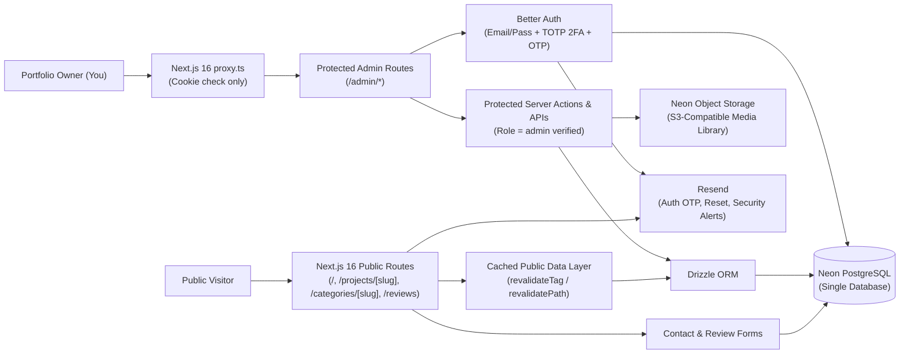

# JaniduDev — Admin Dashboard & CMS Architecture (`ADMIN_DASHBOARD_ARCHITECTURE.md`)

## 1. Architectural Philosophy

1. **Preserve the Public Portfolio:** Keep the existing Next.js 16 + Tailwind + Inter design system, public URLs (`/`, `/projects/[slug]`, `/salon-concepts`, `/reviews`), and fast performance completely intact.
2. **Single Monolith, Clean Boundaries:** Build the admin dashboard inside the same Next.js 16 App Router repository under isolated route groups:
   - `app/(public)/...` — Public portfolio (never imports admin UI or Better Auth client bundles).
   - `app/(auth)/login/...` — Minimal, clean admin sign-in, 2FA challenge, and password recovery screens.
   - `app/(admin)/admin/...` — Protected CMS & Client Management dashboard with its own clean layout (no public navbar/footer).
3. **Zero Infrastructure Exposure:** No API keys, connection strings, SQL queries, JSON blobs, or technical error stack traces ever appear in the dashboard UI.
4. **Database-First with Safe Fallbacks:** Migrate all hardcoded portfolio data into your existing **Neon PostgreSQL** database using **Drizzle ORM** (`drizzle-orm/neon-http`) + versioned SQL migrations (`drizzle-kit`), reusing your existing Neon database without paying for a second database.

---

## 2. Recommended System Architecture

---

## 3. Recommended Technology Choices & Justification

| Concern | Chosen Tool | Why This Fits JaniduDev |
|---|---|---|
| Database | **Existing Neon PostgreSQL** | Already connected and seeded with 46 reviews; zero extra DB hosting cost |
| ORM & Migrations | **Drizzle ORM + `drizzle-kit`** | Lightweight, TypeScript-native, works natively with `@neondatabase/serverless` AND Better Auth's `drizzleAdapter`; generates safe, repeatable SQL migrations |
| Authentication | **Better Auth** (`better-auth` + `twoFactor` + `emailOTP` + `nextCookies`) | Runs inside your own app and Neon DB, zero per-MAU vendor cost, full TOTP 2FA + recovery codes + device session management |
| Transactional Email | **Resend** (`resend`) | Dedicated transactional delivery for OTPs, password resets, security alerts, and enquiry notifications without disrupting your `hello@janidudev.com` business mailbox |
| Media Storage | **Neon Object Storage (S3-compatible)** (`@aws-sdk/client-s3`, `@aws-sdk/s3-request-presigner`) | Keeps database and media unified under Neon with standard S3 API, presigned upload/read URLs, and zero vendor lock-in |
| Validation | **Zod** (`zod`) | Shared strict schema validation for every form, API route, and Server Action |
| Drag & Drop Ordering | **`@dnd-kit/core` + `@dnd-kit/sortable`** | Lightweight, keyboard-accessible reordering (with Up/Down button alternatives for non-mouse users) |
| Rate Limiting | **Neon DB-backed / Upstash Redis (optional)** | Better Auth supports `rateLimit.storage: "database"` out of the box (zero extra cost); optional Upstash Redis free tier can be added if traffic spikes |

---

## 4. Dashboard Navigation Structure (Adapted for Freelance + Client Management)

Clean left sidebar (collapses to a bottom-accessible drawer on mobile/tablet) with **11 focused items** grouped logically:

### Workspace
1. **Overview** (`/admin`) — Business snapshot, pending reviews, unread enquiries, active client projects, quick actions.
2. **Customer Enquiries** (`/admin/enquiries`) — Lead inbox with unread badge, private notes, status tracking, and one-click **"Convert to Client"**.
3. **Clients & Projects** (`/admin/clients`) — Manage paying clients and their active/completed website builds (stages, 50% deposit/final payment tracking, private preview links, launch dates, milestones, and one-click **"Publish to Portfolio"**).

### Portfolio Content
4. **Projects** (`/admin/projects`) — Public portfolio showcase (real client work, demos, design concepts), step-by-step project wizard, drafts, Trash.
5. **Categories** (`/admin/categories`) — Dynamic industry categories (Salons, Restaurants, Hotels, etc.) with drag-and-drop ordering.
6. **Customer Reviews** (`/admin/reviews`) — Moderation inbox (`Published`, `Awaiting approval`, `Hidden`, `In Trash`), manual add, feature toggle.
7. **Website Content** (`/admin/content`) — Edit Hero, Live Interactive Showcase, Process steps, About, Contact info, Footer, Announcement banner, and structured custom sections.
8. **Services** (`/admin/services`) — Manage freelance services (pricing optional, USD/LKR supported, section show/hide toggle).
9. **Media Library** (`/admin/media`) — Drag-and-drop image/video uploads, alt text, search, and usage warnings before deletion.

### Insights & Account
10. **Analytics** (`/admin/analytics`) — Privacy-friendly real visitor & project click metrics (zero fake numbers; clean empty states until traffic accrues).
11. **Settings** (`/admin/settings`) — My Account, Website Info, Security (2FA, Signed-in Devices), Notifications, Appearance (Light/Dark/System).

**Persistent Sidebar Footer Actions:**
- **View Website** (opens `https://www.janidudev.com` in a new tab)
- **Log Out** (signs out current device cleanly)

---

## 5. Feature Classification

### Essential Features (MVP — Phases 1 to 4)
- Better Auth admin login, email verification, TOTP 2FA + recovery codes, Email OTP, forgot/reset password, signed-in devices, single-admin bootstrap script.
- Resend transactional emails (OTP, password reset, security alerts, new enquiry notification, optional customer acknowledgement).
- Dynamic Categories (create/edit/reorder/hide/safe delete) reflected live on the public site.
- Complete Portfolio Projects CMS (wizard, real/demo/concept classification, links, screenshots, draft/publish, featured, live-showcase toggle, Trash & restore).
- Customer Reviews moderation (`Published`, `Awaiting approval`, `Hidden`, `In Trash`, manual add, reorder, feature) + revert public review submission default to `Awaiting approval`.
- Customer Enquiries inbox (read, status, notes, reply via email/WhatsApp, archive, delete).
- **Clients & Client Projects manager** (client directory, convert enquiry → client, track active project stages, deposit/balance payment status, preview URL, milestones, publish to portfolio).
- Website Content editor (Hero, About, Process, Contact details, Social links, Footer) + structured section builder.
- Media Library backed by Neon Object Storage (S3-compatible) with server validation & in-use delete protection.
- Instant public website cache updates (`revalidateTag` / `revalidatePath`) on publish.

### Recommended Features (Phase 5)
- Services manager with optional pricing (`USD`/`LKR`) and public show/hide toggle.
- Content revision history (restore previous published version of a project or website section).
- Draft Preview mode (secure Next.js Draft Mode link so you can preview unpublished projects/categories/sections on the real website before publishing).
- Lightweight privacy-friendly first-party analytics (page views, project views, category views, enquiry & WhatsApp/email click counts stored cleanly in Neon without cookies or personal data).
- Activity history log inside Settings & Overview.

### Optional Future Improvements (Post-Launch)
- Client Portal share link (read-only private progress page per client project showing current stage and private preview link).
- Automated invoice/proposal PDF export for client projects.
- Scheduled publishing (publish a new project or announcement banner on a future date).
- Upstash Redis upgrade for distributed edge rate limiting if traffic scales significantly.

---

## 6. Public Website Integration & Data Migration Strategy

### Public Integration
- Every public route reads from a centralized server data layer (`lib/cms/*.ts`) tagged with Next.js cache tags (`categories`, `projects`, `reviews`, `site-content`, `services`, `site-settings`).
- Whenever you click **Publish Changes** in the dashboard, the Server Action writes to Neon and calls `revalidateTag(...)` + `revalidatePath(...)` automatically — zero manual deploys or cache clearing.
- **Preserved Public URLs:**
  - `/` — Homepage (reads Hero, Live Showcase items, Featured Projects, Dynamic Categories preview, Process, Featured Reviews, About, Contact, and any custom enabled sections).
  - `/projects/[slug]` — All 6 existing slugs (`milan-marble`, `lucia-atelier`, `swiss-classic`, `sf-nail-spa`, `salon-eclat`, `havelock-law-firm`) migrated intact + any newly created project slug works automatically.
  - `/categories/[slug]` — New dynamic industry category route (e.g., `/categories/salons`, `/categories/restaurants`, `/categories/hotels`).
  - `/salon-concepts` — Kept working as an alias rendering the `salons` category from the database so no existing link breaks.
  - `/reviews` — Reads `status = 'published'` reviews from Neon.

### Zero-Loss Data Migration Strategy
1. Take a Neon point-in-time branch/snapshot backup before running migrations.
2. Run additive Drizzle SQL migrations (`ALTER TABLE reviews ADD COLUMN ...`, `ALTER TABLE inquiries ADD COLUMN ...`, `CREATE TABLE ...`) — **never drop or reset existing tables**.
3. Run an idempotent migration script (`scripts/migrate-existing-content.ts`) that:
   - Maps all 46 existing Neon `reviews` into the new `status = 'published'` column without losing a single row.
   - Imports the initial **Salons** category from `lib/salon-concepts.ts` and **Legal & Professional Services** category from `lib/data.ts`.
   - Imports all 6 projects from `lib/data.ts` and all 11 salon design concepts from `lib/salon-concepts.ts` (avoiding duplicates for `milan-marble`, `lucia-atelier`, `swiss-classic`, linking their real local `/assets/...` screenshots into `media_assets`).
   - Seeds `site_settings` and `website_sections` with your exact current homepage copy, contact details (`hello@janidudev.com`, `+94 72 625 4163`, `Kandy, Sri Lanka`, LinkedIn), and 4-step process.

---

## 7. Email Delivery Architecture (Resend vs. Business Mailbox)

- **Resend** handles all automated application emails from a dedicated verified subdomain (e.g., `notifications@mail.janidudev.com` or `no-reply@janidudev.com`):
  - Admin login verification, Email OTPs, Password Reset, Password Changed alert, New Device Sign-in alert.
  - New Customer Enquiry notification (sent to `hello@janidudev.com` with `Reply-To` set to the customer's email so clicking Reply in your normal inbox replies directly to the client!).
  - Optional Customer Enquiry acknowledgement.
- **Your Existing Business Mailbox (`hello@janidudev.com`)** remains 100% untouched for personal client conversations (MX records stay on your email provider; Resend uses separate SPF/DKIM DNS records on the sending subdomain).

---

## 8. Estimated Infrastructure Costs (Monthly)

| Service | Plan | Estimated Monthly Cost | Notes |
|---|---|---|---|
| **Vercel** (Hosting + Next.js) | Hobby (or Pro if team/higher limits needed) | **\$0** (Hobby) / \$20 (Pro) | Existing hosting |
| **Neon PostgreSQL** | Free Tier (0.5 GB storage, 100 CU-hours) | **\$0** | Easily holds thousands of projects, reviews, clients & enquiries |
| **Neon Object Storage** (Media Library) | S3-compatible object storage | **\$0** (low portfolio usage) | Unified under your Neon account; standard S3 API via `@aws-sdk/client-s3` |
| **Resend** (Transactional Email) | Free Tier (3,000 emails/month, 100/day) | **\$0** | More than enough for freelance enquiries + admin auth emails |
| **Better Auth** | Open-source library | **\$0** | Self-hosted inside your app + Neon DB |
| **Total Expected Monthly Cost** | | **\$0 / month** | Zero recurring SaaS CMS fees |
