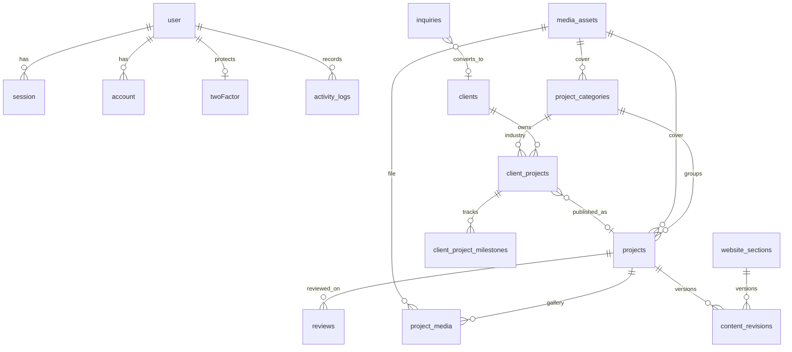

# JaniduDev — PostgreSQL Database Schema (`DATABASE_SCHEMA.md`)

**Database Engine:** Neon PostgreSQL (existing instance)  
**ORM & Migrations:** Drizzle ORM (`drizzle-orm/neon-http`) + `drizzle-kit` SQL migrations  
**Migration Safety Rule:** Strictly additive over existing `reviews` and `inquiries` tables. Never drop or truncate production data.

---

## 1. Entity Relationship Overview

---

## 2. Authentication Tables (Managed by Better Auth)

Generated and migrated cleanly via Better Auth + Drizzle adapter (`better-auth/adapters/drizzle`):

1. **`user`** — `id`, `name`, `email` (unique), `email_verified`, `image`, `role` (`'admin'` — enforced server-side), `two_factor_enabled`, `created_at`, `updated_at`.
2. **`session`** — `id`, `user_id` (FK → `user.id`), `token` (unique), `expires_at`, `ip_address`, `user_agent`, `created_at`, `updated_at`. Powers **Signed-in Devices** and **Sign Out Other Devices**.
3. **`account`** — `id`, `user_id` (FK → `user.id`), `account_id`, `provider_id` (`'credential'`), `password` (scrypt hashed by Better Auth), `created_at`, `updated_at`.
4. **`verification`** — `id`, `identifier`, `value` (hashed/opaque token or OTP), `expires_at`, `created_at`, `updated_at`. Powers email verification, password reset, and Email OTPs.
5. **`two_factor`** — `id`, `user_id` (FK → `user.id`), `secret` (encrypted TOTP secret), `backup_codes` (encrypted single-use recovery codes).

---

## 3. Portfolio CMS Tables

### `media_assets` (Centralized Media Library)
| Column | Type | Constraints / Notes |
|---|---|---|
| `id` | `text` (UUID/nanoid) | Primary key |
| `storage_provider` | `text` | `'neon_s3'` or `'local_static'` (for migrated `/public` assets) |
| `url` | `text` | Public object URL or `/assets/...` path (`NOT NULL`) |
| `object_key` | `text` | S3 object key (`media/YYYY-MM/<uuid>.<ext>`) for clean deletion & presigning |
| `file_name` | `text` | Original user-friendly filename |
| `mime_type` | `text` | Validated server-side (`image/jpeg`, `image/png`, `image/webp`, `image/avif`, `video/mp4`, `video/webm`) |
| `size_bytes` | `integer` | Validated max size (e.g., 10 MB images, 50 MB videos) |
| `width` / `height` | `integer` | Nullable dimensions for aspect-ratio stability |
| `alt_text` | `text` | Default accessibility description |
| `folder` | `text` | `'projects'`, `'categories'`, `'branding'`, `'reviews'`, `'general'` |
| `created_at` | `timestamptz` | Default `NOW()` |
| `deleted_at` | `timestamptz` | Soft delete (Trash) |

*Usage protection:* Before deleting a `media_assets` row, the backend checks references across `project_categories.cover_media_id`, `projects.cover_media_id`, `project_media.media_id`, `website_sections.content_json`, `services.media_id`, and `site_settings` and warns the admin with the exact list of places using that file.

### `project_categories` (Dynamic Industry Categories)
| Column | Type | Constraints / Notes |
|---|---|---|
| `id` | `text` | Primary key |
| `name` | `text` | `NOT NULL` (e.g., `"Salons"`, `"Restaurants"`, `"Hotels"`) |
| `slug` | `text` | `UNIQUE NOT NULL` (auto-generated editable page link, e.g., `"restaurants"`) |
| `section_title` | `text` | `NOT NULL` (e.g., `"Modern Restaurant Websites"`) |
| `section_subtitle` | `text` | Optional eyebrow/subtitle |
| `description` | `text` | Short plain-English description |
| `cover_media_id` | `text` | Nullable FK → `media_assets.id` (`ON DELETE SET NULL`) |
| `icon_name` | `text` | Optional Lucide icon key |
| `display_order` | `integer` | `NOT NULL DEFAULT 0` |
| `status` | `text` | `'draft' | 'published'` (`NOT NULL DEFAULT 'draft'`) |
| `is_visible` | `boolean` | `NOT NULL DEFAULT TRUE` |
| `seo_title` | `text` | Optional meta title |
| `seo_description` | `text` | Optional meta description |
| `created_at` / `updated_at` | `timestamptz` | Auto-managed |
| `deleted_at` | `timestamptz` | Soft delete (Trash) |

*Safe category deletion:* Foreign key on `projects.category_id` uses `ON DELETE SET NULL` (never `CASCADE`), and the delete dialog explicitly offers: **Move projects to another category** or **Keep projects uncategorized**.

### `projects` (Public Portfolio Showcase Items)
| Column | Type | Constraints / Notes |
|---|---|---|
| `id` | `text` | Primary key |
| `category_id` | `text` | Nullable FK → `project_categories.id` (`ON DELETE SET NULL`) |
| `title` | `text` | `NOT NULL` |
| `slug` | `text` | `UNIQUE NOT NULL` (preserves `/projects/milan-marble`, `/projects/lucia-atelier`, etc.) |
| `classification` | `text` | `'client_work' | 'demo' | 'design_concept' | 'personal'` (`NOT NULL`) |
| `project_type` | `text` | E.g., `"Nail salon"`, `"Hair & beauty salon"`, `"Law firm"` |
| `short_description` | `text` | Card lead summary |
| `full_description` | `text` | Case study intro |
| `brief_text` | `text` | Case study: The brief |
| `what_i_built_json` | `jsonb` | `string[]` bullet points |
| `verified_outcomes_json` | `jsonb` | `string[]` verified delivery notes |
| `client_name` | `text` | Optional public client/business name |
| `country` | `text` | Optional country code/name |
| `completed_at` | `date` | Optional completion date |
| `live_url` | `text` | Optional live client website URL |
| `demo_url` | `text` | Optional interactive demo URL |
| `custom_links_json` | `jsonb` | `Array<{ label: string; url: string }>` |
| `cover_media_id` | `text` | Nullable FK → `media_assets.id` (`ON DELETE SET NULL`) |
| `video_media_id` | `text` | Nullable FK → `media_assets.id` (`ON DELETE SET NULL`) |
| `show_in_live_showcase` | `boolean` | `NOT NULL DEFAULT FALSE` (controls interactive iframe tabs on homepage) |
| `is_featured` | `boolean` | `NOT NULL DEFAULT FALSE` |
| `show_on_homepage` | `boolean` | `NOT NULL DEFAULT FALSE` |
| `display_order` | `integer` | `NOT NULL DEFAULT 0` |
| `status` | `text` | `'draft' | 'published'` (`NOT NULL DEFAULT 'draft'`) |
| `is_visible` | `boolean` | `NOT NULL DEFAULT TRUE` |
| `seo_title` / `seo_description` | `text` | Optional SEO overrides |
| `created_at` / `updated_at` / `deleted_at` | `timestamptz` | Lifecycle timestamps |

### `project_media` (Screenshots & Gallery Items)
| Column | Type | Constraints / Notes |
|---|---|---|
| `id` | `text` | Primary key |
| `project_id` | `text` | `NOT NULL` FK → `projects.id` (`ON DELETE CASCADE`) |
| `media_id` | `text` | `NOT NULL` FK → `media_assets.id` (`ON DELETE RESTRICT`) |
| `device_type` | `text` | `'desktop' | 'mobile' | 'gallery'` |
| `title` | `text` | Optional screen heading |
| `caption` | `text` | Optional caption |
| `alt_text` | `text` | Per-placement alt text override |
| `display_order` | `integer` | `NOT NULL DEFAULT 0` |

### `reviews` (Extended In-Place from Existing Table)
Additive columns on the existing `reviews` table (keeping all 46 existing rows intact):
- `status` (`text NOT NULL DEFAULT 'pending'`) — `'published' | 'pending' | 'hidden' | 'trashed'` (backfilled to `'published'` for existing `approved = TRUE` rows)
- `project_id` (`text` nullable FK → `projects.id` `ON DELETE SET NULL`)
- `client_photo_media_id` (`text` nullable FK → `media_assets.id` `ON DELETE SET NULL`)
- `source` (`text NOT NULL DEFAULT 'website_form'`) — `'website_form' | 'manual_admin' | 'email' | 'whatsapp'`
- `display_order` (`integer NOT NULL DEFAULT 0`)
- `moderated_at` (`timestamptz`), `moderation_note` (`text` — private internal note), `deleted_at` (`timestamptz`)

---

## 4. Client & Active Project Management Tables (New Module)

Designed specifically for managing your paying clients and their active website builds privately inside the dashboard:

### `clients`
| Column | Type | Constraints / Notes |
|---|---|---|
| `id` | `text` | Primary key |
| `name` | `text` | `NOT NULL` (Client contact name) |
| `business_name` | `text` | Optional business/salon/firm name |
| `email` | `text` | Client email |
| `phone` | `text` | Phone or WhatsApp number |
| `country` | `text` | `NOT NULL DEFAULT 'USA'` |
| `status` | `text` | `'lead' | 'active' | 'completed' | 'paused' | 'archived'` (`NOT NULL DEFAULT 'active'`) |
| `source_inquiry_id` | `text` | Nullable FK → `inquiries.id` (`ON DELETE SET NULL`) |
| `private_notes` | `text` | Internal client notes |
| `created_at` / `updated_at` / `deleted_at` | `timestamptz` | Lifecycle timestamps |

### `client_projects`
| Column | Type | Constraints / Notes |
|---|---|---|
| `id` | `text` | Primary key |
| `client_id` | `text` | `NOT NULL` FK → `clients.id` (`ON DELETE RESTRICT`) |
| `category_id` | `text` | Nullable FK → `project_categories.id` (`ON DELETE SET NULL`) |
| `title` | `text` | `NOT NULL` (e.g., `"Bellevue Hair Studio Redesign"`) |
| `stage` | `text` | `'proposal_sent' | 'deposit_received' | 'in_development' | 'preview_ready' | 'revisions' | 'final_payment' | 'launched' | 'maintenance'` |
| `agreed_amount` | `numeric(12,2)` | Optional fixed proposal total |
| `currency` | `text` | `'USD' | 'LKR' | 'GBP' | 'AUD' | 'CAD' | 'EUR'` (`DEFAULT 'USD'`) |
| `deposit_paid` | `boolean` | `NOT NULL DEFAULT FALSE` (50% deposit status) |
| `deposit_paid_at` | `date` | Optional date |
| `final_paid` | `boolean` | `NOT NULL DEFAULT FALSE` (Final 50% status) |
| `final_paid_at` | `date` | Optional date |
| `start_date` | `date` | Optional start date |
| `target_launch_date` | `date` | Optional target launch date |
| `launched_at` | `date` | Optional actual launch date |
| `private_preview_url` | `text` | Staging / private preview link |
| `live_site_url` | `text` | Production client domain |
| `portfolio_project_id` | `text` | Nullable FK → `projects.id` (`ON DELETE SET NULL`) — linked if published to showcase |
| `private_notes` | `text` | Scope notes, revision notes, handover checklist |
| `created_at` / `updated_at` / `deleted_at` | `timestamptz` | Lifecycle timestamps |

### `client_project_milestones`
| Column | Type | Constraints / Notes |
|---|---|---|
| `id` | `text` | Primary key |
| `client_project_id` | `text` | `NOT NULL` FK → `client_projects.id` (`ON DELETE CASCADE`) |
| `title` | `text` | E.g., `"Proposal approved"`, `"50% deposit received"`, `"Homepage preview sent"`, `"Revisions completed"`, `"Domain connected"` |
| `is_completed` | `boolean` | `NOT NULL DEFAULT FALSE` |
| `due_date` | `date` | Optional target date |
| `completed_at` | `timestamptz` | Optional timestamp |
| `display_order` | `integer` | `NOT NULL DEFAULT 0` |

---

## 5. Enquiries, Website Content, Services, Settings & Analytics Tables

### `inquiries` (Extended In-Place from Existing Table)
Additive columns on existing `inquiries`:
- `phone` (`text`), `requested_service` (`text`), `budget` (`text`)
- `is_read` (`boolean NOT NULL DEFAULT FALSE`)
- `private_notes` (`text`)
- `converted_client_id` (`text` nullable FK → `clients.id` `ON DELETE SET NULL`)
- `updated_at` (`timestamptz NOT NULL DEFAULT NOW()`), `deleted_at` (`timestamptz`)
- Status values standardized: `'new' | 'contacted' | 'discussing' | 'confirmed' | 'closed' | 'archived'`

### `website_sections` (Dynamic Page Content & Structured Section Builder)
- `id`, `page_key` (`'home'`), `section_key` (unique nullable for core sections like `'hero'`, `'process'`, `'about'`, `'announcement'`), `template_type` (`'hero' | 'live_showcase' | 'featured_projects' | 'categories' | 'process' | 'reviews' | 'about' | 'contact' | 'text_image' | 'services_grid' | 'faq' | 'stats' | 'cta' | 'gallery'`), `title`, `content_json` (`jsonb` — strictly validated per template by Zod, zero raw HTML/JS), `draft_content_json` (`jsonb` — unpublished edits), `display_order`, `status` (`'draft' | 'published'`), `is_visible`, `updated_at`.

### `services` (Optional Pricing & Visibility)
- `id`, `name`, `description`, `icon_name`, `media_id` (FK → `media_assets.id`), `features_json` (`jsonb` `string[]`), `starting_price` (`numeric(12,2)` nullable — optional!), `currency` (`'USD' | 'LKR' | 'GBP' | 'AUD'`), `delivery_estimate` (`text`), `cta_label`, `cta_href`, `display_order`, `is_visible` (`boolean DEFAULT FALSE` initially so nothing changes on your public site until you turn it on), `created_at`, `updated_at`, `deleted_at`.

### `site_settings` (Single-Row Configuration)
- `id` (`'default'` PK), `site_name`, `site_tagline`, `logo_media_id`, `favicon_media_id`, `public_email`, `public_whatsapp`, `location_text`, `client_markets_text`, `linkedin_url`, `other_socials_json`, `default_seo_title`, `default_seo_description`, `notify_new_enquiry` (`boolean`), `notify_new_review` (`boolean`), `notify_security_alerts` (`boolean`), `updated_at`.

### `content_revisions` & `activity_logs` & `email_logs` & `analytics_events`
- **`content_revisions`**: `id`, `entity_type` (`'project' | 'category' | 'section' | 'service'`), `entity_id`, `snapshot_json` (`jsonb`), `summary`, `created_by`, `created_at`. Lets you undo accidental edits in one click.
- **`activity_logs`**: `id`, `actor_user_id`, `action` (human-readable label like `"Published project Milan Marble"`), `entity_type`, `entity_id`, `ip_address`, `created_at`.
- **`email_logs`**: `id`, `template_name`, `recipient_domain` (or masked email), `status` (`'sent' | 'failed'`), `provider_message_id`, `created_at`.
- **`analytics_events`**: `id`, `event_type` (`'page_view' | 'project_view' | 'category_view' | 'whatsapp_click' | 'email_click' | 'demo_click' | 'enquiry_submit'`), `path`, `entity_slug`, `country_code` (from Vercel `x-vercel-ip-country` header — zero cookies, zero IP storage!), `created_at`.
